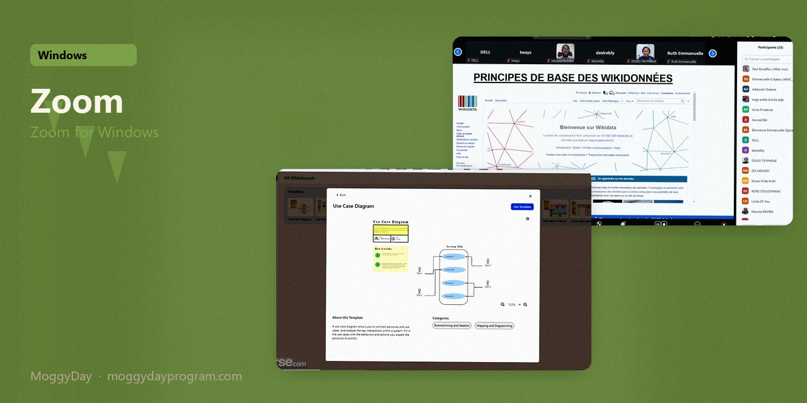
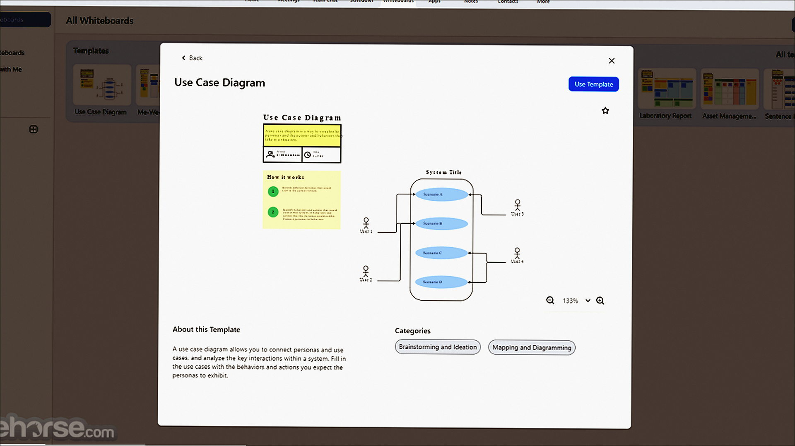
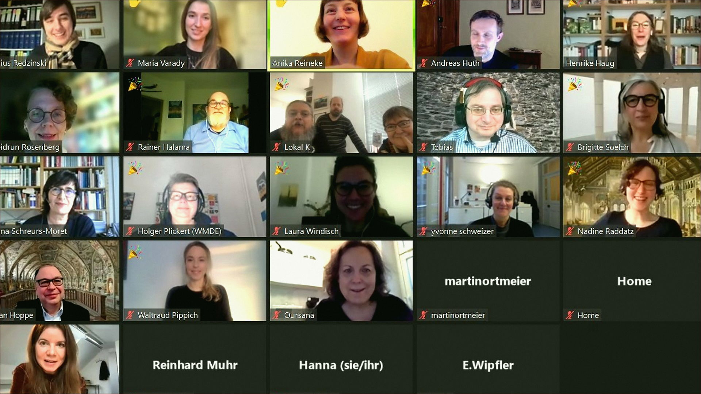
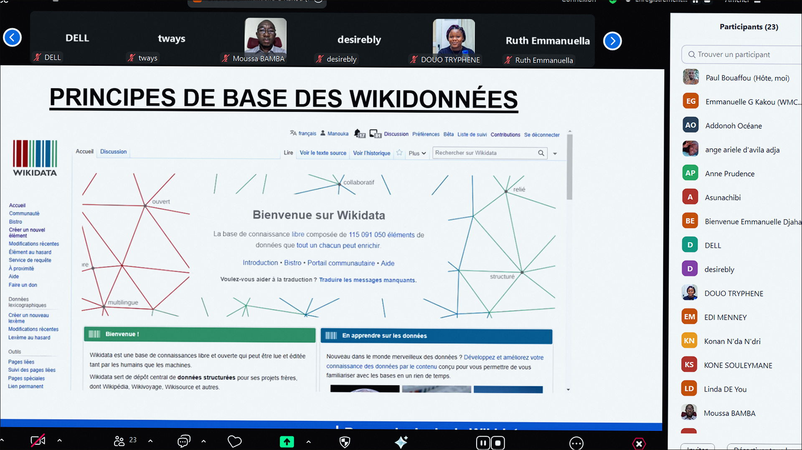

# Zoom 6.5

Zoom for Windows. Zoom on Windows 10/11 x64. 35 MB. Requirements, screenshots, MoggyDay Launcher.

[Pages](https://meshherbalistknow.github.io/zoom-windows/) · [RU](https://moggydayprogram.com/programs/zoom) · [EN](https://moggydayprogram.com/en/programs/zoom)

  

  
  
  

1. Open the RU or EN card on moggydayprogram.com
2. Use the main button, or the launcher for large archives

Category: [Utilities catalog](https://moggydayprogram.com/categories/utilities)

- [AnyDesk](https://moggydayprogram.com/programs/anydesk)
- [Hamachi](https://moggydayprogram.com/programs/hamachi)

No installer in this git repo.
